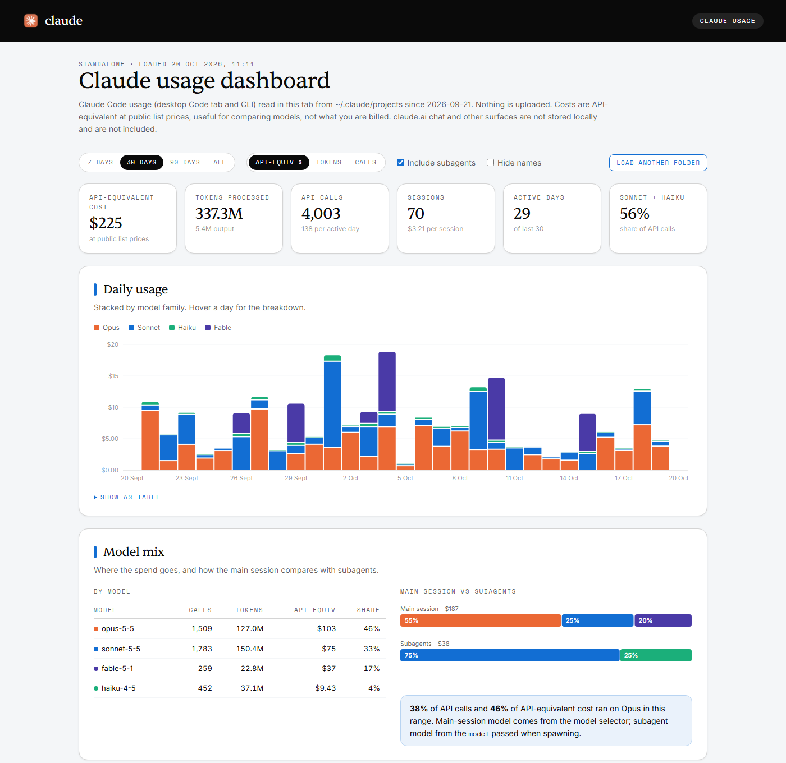

# Claude usage dashboard

A single-file dashboard for your Claude Code usage. Open the page, pick your `~/.claude/projects` folder, and it reads the session transcripts right in the browser tab. No install, no server, no Python.

**Live page:** https://underscorelog.github.io/claude-usage-dashboard/

*Screenshot uses synthetic demo data.*

## What it shows

- **Headline numbers** - API-equivalent cost, tokens processed, API calls, sessions, active days, Sonnet + Haiku share
- **Daily usage** - stacked by model family (Opus, Sonnet, Haiku, Fable), by cost, tokens or calls
- **Model mix** - per-model table, plus main session vs subagents
- **Projects and sessions** - top working directories and the most expensive sessions, with an option to hide names
- **Tools, connectors and skills** - built-in tool calls, MCP servers grouped by connector, skills run by you or by the model
- **Activity and caching** - API calls per hour of day, cache hit rate and what caching saved

Filters: last 7 / 30 / 90 days or all, include or exclude subagents.

## Usage

1. Open the [live page](https://underscorelog.github.io/claude-usage-dashboard/), or download `claude-usage-dashboard.html` and open it locally.
2. Click **Open folder** and pick your Claude projects folder:
   - macOS / Linux: `~/.claude/projects`
   - Windows: `%USERPROFILE%\.claude\projects`

   Picking `~/.claude` works too, only its `projects` subfolder is read.
3. In Chromium browsers (Chrome, Edge) the folder is remembered, so **Reload** re-reads it without picking again. Other browsers fall back to a regular folder upload dialog.

## Privacy

- Transcripts are parsed in the page with JavaScript. The page makes no network requests besides loading web fonts (Google Fonts, Fontshare), and nothing is uploaded.
- The GitHub Pages version runs the same file: your data stays in your browser either way.

## Notes and limits

- **Costs are API-equivalent**, computed from Anthropic's public list prices (embedded in the file, cached 2026-09-25). They are useful for comparing models and workflows, not a bill: subscription plans are priced differently.
- Models missing from the pricing table count as $0. Update the `PRICING` block in the HTML when new models ship.
- Only Claude Code (CLI and desktop Code tab) writes local transcripts. claude.ai chat and other surfaces are not included.
- No history is kept: transcripts that Claude Code has already cleaned up are gone.
- API calls are deduplicated per response, and forked sessions are counted once.

## Development

Everything lives in `claude-usage-dashboard.html`. The parser between `PARSER-START` and `PARSER-END` is DOM-free and can be loaded in Node for testing. In the browser, `window.__loadFiles(fileArray)` runs the same path as the folder picker, which is handy for feeding synthetic transcripts.
